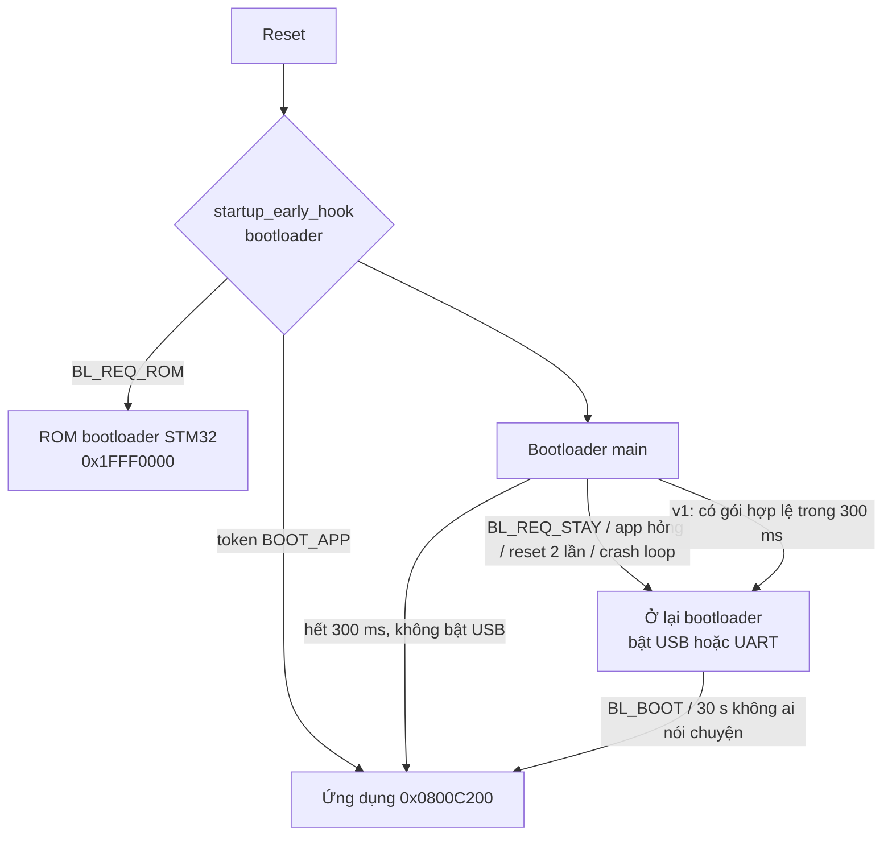

# Kiến trúc firmware

## Tổng quan

```mermaid
flowchart LR
  IMU[ICM-42688-P<br/>SPI1 + DMA] -->|INT1 1 kHz| SWI
  PPM[PPM J3.4<br/>EXTI + TIM2] --> SWI
  TOF[VL53L1<br/>I2C2 + DMA] --> SWI
  ADC[ADC1 + DMA<br/>VBAT, VREFINT, nhiệt độ] --> BAT[battery.c]
  BAT --> SWI
  SWI["Flight loop (ngắt mềm, 1 kHz)<br/>fc.c"] --> PWM[TIM3 PWM 32 kHz<br/>M1–M4]
  SWI --> RINGS[tlm_rings]
  MAIN["Main loop<br/>sched.c"] --> COMMS[comms.c] <-->|link_port: USB CDC (v2)<br/>hoặc USART1 + DMA (v1)<br/>COBS/CRC| WEB[Trang cấu hình]
  RINGS --> COMMS
  MAIN --> NOTIFY[notify.c<br/>LED + còi]
  COMMS --> PARAMS[params + config_store<br/>flash sector 1–2]
```

Hai tầng chạy song song:

- **Flight loop** – mọi thứ cần đúng thời điểm. Ngắt INT1 của IMU (1 kHz) khởi động đọc 15 byte bằng SPI DMA; khi DMA xong, `FLIGHT_SWI` (vector FSMC bỏ trống, ưu tiên 8) được pend và `fc_update()` chạy trong đó: lọc, ước lượng, điều khiển, mixer, ghi PWM. Không chờ bận, không truy cập flash.
- **Main loop** – bộ lập lịch hợp tác (`system/sched.c`): `comms` (liên tục), `tof` (máy trạng thái I2C), `battery` (5 ms), `notify` (10 ms), `house` (10 ms: lưu kết quả hiệu chuẩn gia tốc, thử lại IMU, nuôi watchdog), `stats` (1 s). Tải CPU được báo trong telemetry.

Hai tầng trao đổi qua cấu trúc nhỏ có seqlock (`fc_get_status`, đầu vào pin/ToF/RC) và hàng đợi SPSC (sự kiện, telemetry tốc độ cao). Tham số đọc trực tiếp từ `g_cfg` (truy cập 32 bit là nguyên tử trên Cortex-M4); module nào cache hệ số thì so `g_cfg_revision`.

## Khởi động



- Vùng RAM chia sẻ 64 byte ở `0x2001FFC0` (`shared_ram.h`, không bị xoá khi reset) mang yêu cầu giữa ứng dụng và bootloader, số lần khởi động, `RCC->CSR` lúc reset và bộ đếm khởi động chưa xác nhận (phát hiện crash loop, `bl_policy.c`).
- Bootloader kiểm tra image ứng dụng trước khi nhảy: magic, CRC header, CRC image, board id, SP/PC hợp lệ (`bl_image.c`).
- Ứng dụng: `clock_init()` (HSE 8 MHz → 168 MHz; hỏng thạch anh thì chạy HSI và báo lỗi), bảo vệ stack bằng MPU, khởi tạo driver, nạp cấu hình, bật IMU, watchdog 250 ms.

## Bộ nhớ

| Vùng | Địa chỉ | Kích thước | Nội dung |
|---|---|---|---|
| Sector 0 | 0x08000000 | 16 KB | Bootloader |
| Sector 1 | 0x08004000 | 16 KB | Cấu hình bank A |
| Sector 2 | 0x08008000 | 16 KB | Cấu hình bank B |
| Sector 3… | 0x0800C000 | 976 KB | Header 512 B + ứng dụng (vector ở 0x0800C200) |
| SRAM | 0x20000000 | 128 KB – 64 B | .data, .bss, buffer DMA |
| Shared | 0x2001FFC0 | 64 B | RAM chia sẻ bootloader ↔ ứng dụng |
| CCM | 0x10000000 | 64 KB | Stack ứng dụng 16 KB (vùng cấm MPU 32 B ở đáy), `.ccm_bss` |

Linker script được sinh từ `memory_map.h` bằng bộ tiền xử lý C, nên chỉ có một nguồn sự thật cho địa chỉ. Buffer DMA nằm trong SRAM (DMA không với tới CCM).

## Ngắt và DMA

| Ưu tiên | Ngắt | Việc |
|---|---|---|
| 1 | EXTI15_10 | Cạnh PPM (đóng dấu thời gian TIM2), cờ ngắt ToF |
| 2 | EXTI3, DMA2 Stream0 | IMU data-ready → SPI DMA → pend flight loop |
| 3 | SysTick 1 kHz | Đồng hồ ms, giám sát flight loop (treo > 20 ms → tắt motor) |
| 5 | I2C2 EV/ER, DMA1 Stream2/7 | ToF |
| 6 | OTG_FS (v2) / DMA2 Stream7 (v1) | USB CDC / UART TX |
| 8 | FSMC (ngắt mềm) | Flight loop `fc_update()` |

| Ngoại vi | DMA | Chế độ |
|---|---|---|
| SPI1 RX / TX (IMU) | DMA2 S0 / S3, kênh 3 | một lần cho mỗi mẫu, 10,5 MHz |
| USART1 RX / TX (link, v1) | DMA2 S2 / S7, kênh 4 | RX vòng 1 KB, TX ring 4 KB |
| USB OTG FS (link, v2) | – (FIFO riêng 1,25 KB của core) | RX ring 1 KB, TX ring 4 KB, một gói 64 B mỗi ngắt |
| ADC1 (pin, VREFINT, nhiệt độ) | DMA2 S4, kênh 0 | vòng, 32 lần quét, lấy trung bình |
| I2C2 RX / TX (ToF) | DMA1 S2 / S7, kênh 7 | theo từng giao dịch |

## Đường truyền tới trang cấu hình

`hal/link_port.h` che phiên bản board: `link_port_init/read/write/tx_free/tx_idle/task/detach`. `comms.c` (giao thức ứng dụng) và bootloader chỉ thấy dòng byte.

- **Board v2 – USB** (`common/usb/`): `usb_dwc2.c` là tầng điều khiển cho core OTG_FS (Synopsys DWC2, chế độ slave không DMA): FIFO nhận chung đọc theo từ trạng thái `GRXSTSP`, mỗi endpoint IN một FIFO phát, mỗi lần một gói. `usb_cdc.c` không phụ thuộc phần cứng: descriptor, request chương 9, CDC ACM (line coding, DTR/RTS), hai ring SPSC, flow control (OUT chỉ được mở lại khi ring còn ≥ 64 byte, máy tính nhận NAK trong lúc chờ), ZLP sau gói 64 byte cuối, D+ chỉ bật khi thấy VBUS trên PA9. Ứng dụng chạy bằng ngắt OTG_FS (ưu tiên 6, phía luồng chỉ ghi ring rồi pend ngắt); bootloader chạy kiểu polling trong vòng lặp chính. Test `tests/unit/test_usb.c` chạy `usb_cdc.c` với một host giả lập.
- **Board v1 – UART** (`hal/uart_link.c`): USART1, RX bằng DMA vòng, TX ring + DMA.

## Flight loop (`flight/fc.c`)

1. Mẫu IMU (đổi về khung thân FRD theo `board_yaw`) → trừ bias gyro (hiệu chuẩn lúc đứng yên) và offset gia tốc.
2. Gyro: notch 1, notch 2, LPF (PT1 hoặc biquad). Gia tốc: LPF.
3. Tư thế: Mahony (Kp lớn trong 2 s đầu để hội tụ nhanh, chỉ tin gia tốc kế khi |a| gần 1 g).
4. Độ cao: Kalman 3 trạng thái (cao, vận tốc, bias gia tốc) với số đo ToF trễ (bù bằng lịch sử), bù nghiêng.
5. RC: chuẩn hoá, deadband, expo, làm mượt; công tắc ARM / chế độ / còi.
6. ARM / failsafe / va chạm / chế độ bay (ACRO, ANGLE, ALT HOLD, FAILSAFE).
7. Vòng góc (ANGLE) → setpoint tốc độ góc → PID (D trên phép đo, D-term 2 tầng lọc, feedforward, chống windup khi mixer bão hoà).
8. Giữ độ cao: PI vận tốc đứng + P độ cao, ga treo tự học (ước lượng từ gia tốc thực đo khi bay ổn định), các pha cất cánh / bay / hạ cánh cuối.
9. Mixer (ưu tiên roll/pitch, giới hạn yaw, airmode tuỳ chọn) → tuyến tính hoá lực đẩy → bù điện áp pin → duty PWM.
10. Mỗi `divider` vòng đẩy mẫu telemetry tốc độ cao vào ring; 100 Hz công bố trạng thái (seqlock).

`fc.c` không chạm phần cứng: cùng file chạy trên MCU, trong mô phỏng (`tests/sim`) và trong emulator WebAssembly.

## Tham số và lưu cấu hình

- `config/params_list.h` là bảng duy nhất (X-macro): tên, kiểu, trường trong `config_t`, mặc định, min, max, cờ. Thêm một dòng là có ngay trong flash, giao thức và trang web.
- Cờ: `LIVE` (đổi được khi đang bay – PID, bộ lọc, rate…), `REBOOT` (cần khởi động lại), `CAL` (do hiệu chuẩn ghi).
- `config_store.c`: 2 bank, mỗi bank là log chỉ ghi thêm các bản ghi `{magic, version, count, seq, crc32} + {key, value}…`. `key` = FNV-1a của tên, nên đổi thứ tự hay thêm/bớt tham số không làm mất giá trị cũ. Hết chỗ thì xoá bank kia và ghi sang; mất điện giữa chừng vẫn còn bản ghi trước.
- Lưu chỉ được khi DISARM; trong lúc xoá sector (~0,3 s) watchdog được nới 4 s và việc ARM bị chặn.

## Giao tiếp

`comms/comms.c` xử lý giao thức (xem [protocol.md](protocol.md)) qua giao diện `app_services.h`; phần phụ thuộc phần cứng nằm trong `app/app_services.c`. Nhờ vậy cùng `comms.c` chạy trong emulator, và trang web được kiểm thử với chính mã C đó.

## An toàn

- ARM chỉ khi: có PPM, ga thấp, quad gần nằm ngang (`arm_angle`), gyro đã hiệu chuẩn, IMU tốt, có pin (không chỉ nguồn USB) và pin không ở mức nguy hiểm, không test motor, không đang lưu cấu hình, quá 2 s sau khởi động, và công tắc ARM đã được gạt về OFF trước đó (không ARM khi vừa có lại sóng).
- Failsafe khi mất PPM (`rx_fs_ms`): tự hạ cánh (có ToF: theo tốc độ `alt_land_vz`; không ToF: ga 0,85 × ga treo) rồi tắt motor khi chạm đất hoặc sau `fs_land_s`; hoặc tắt motor ngay (`fs_mode = 0`).
- Va chạm: nghiêng quá `crash_angle` lâu hơn `crash_ms` (hoặc nằm yên lật ngược) → tắt motor, còi định vị.
- Giám sát: SysTick kiểm tra flight loop; IWDG 250 ms; HardFault/MemManage/BusFault/UsageFault tắt motor, ghi bản ghi vào `.noinit` rồi reset (đọc lại ở trang Firmware).
- Lệnh từ máy tính bị từ chối khi đang ARM (trừ đổi tham số `LIVE`); test motor cần khoá `0xA5` và tự dừng sau 0,5 s; telemetry và test motor dừng khi máy tính im lặng 3 s.

## Kiểm thử không cần phần cứng

| Lớp | Ở đâu | Chạy gì |
|---|---|---|
| Đơn vị | `tests/unit` | các module thuần (lọc, PID, mixer, KF, tham số, bootloader + quyết định khởi động, giao thức, stack USB CDC với host giả lập…) |
| Mô phỏng vòng kín | `tests/sim` | `fc.c` thật + mô hình quad 30 g (độ trễ motor, đường cong lực đẩy khác giả định, sụt áp pin, rung, ToF trễ) |
| Emulator board | `tests/emu` | bootloader + quyết định khởi động, ROM bootloader (AN3155), ứng dụng, flash; đường truyền USB CDC (v2: mất khi MCU reset, enumerate lại) hoặc UART 460800 baud (v1); build cho cả hai board; bản native cho test Node, bản WebAssembly cho chế độ mô phỏng của trang web |
